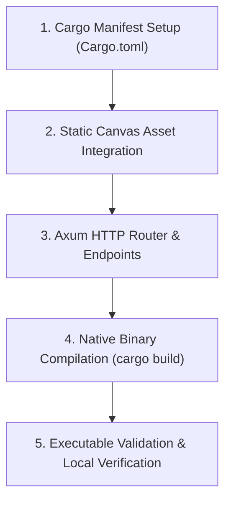

# Rust Server Implementation & Execution Plan

## Phase Breakdown

### Phase 1: Native Rust Server Crate
- Create root `Cargo.toml` configuring the application binary `pokerescue-server`.
- Add minimal, battle-tested dependencies (`axum`, `tokio`, `serde`, `serde_json`, `tower-http`).

### Phase 2: Static Canvas and Blank Page Integration
- Embed the analyzed static dot-grid canvas directly into the Rust server binary using `include_str!` or static routing.
- Canvas uses `#D8D8D8` background with `#C4C4C4` micro-dots on a 6px pitch.
- Zero client-side JavaScript libraries; zero magnetic cursor physics.

### Phase 3: REST & Health Endpoints
- `/`: Delivers the clean blank page with the exact static dot-grid canvas.
- `/api/health`: System health and server diagnostics.
- `/api/v1/incidents`: Initial typed incident list endpoint.

### Phase 4: Build & Packaging
- Local compilation: `cargo build --release` produces native binary.
- Windows compilation: produces standalone `pokerescue-server.exe`.
