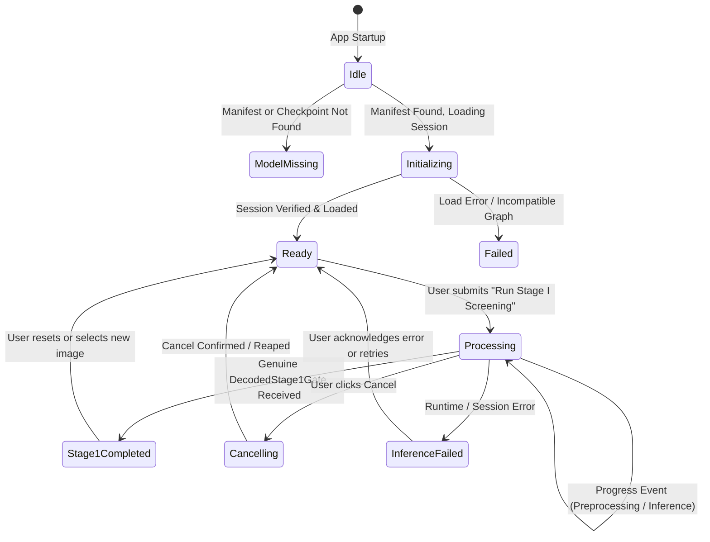

# 06. Request and Event State Machine

## Lifecycle Diagram

## Examination Isolation Rules
1. Every outgoing request records `examination_id` and `image_hash`.
2. When the GUI changes active examination, the active `pending_request_id` is updated.
3. If an incoming `InferenceEvent::Stage1Completed` matches an old or superseded `request_id` or `examination_id`, it is dropped with an informational log: `Stale event rejected`.
4. Result state is tied to `(examination_id, image_path)`. Replacing the image resets the analysis state to Idle.
