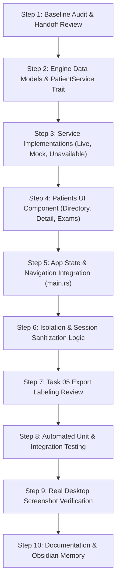

# GUI Phase 1 • Task 06: Implementation Plan

## 1. Work Breakdown & Execution Phases

## 2. File Targets & Modifications

1. `rust/src/engine/patient.rs` (New): Data contracts, error models, service traits, live adapter, mock service, and unit tests.
2. `rust/src/engine/mod.rs` (Modify): Re-export `patient` module.
3. `rust/src/ui/patients.rs` (New): Patient directory UI, patient detail editor, examination list, image linker, and navigation toolbar.
4. `rust/src/ui/mod.rs` (Modify): Re-export `patients` module.
5. `rust/src/domain.rs` (Modify): Add patient and examination routing references.
6. `rust/src/main.rs` (Modify): Add `AppPage::Patients`, wire patient service, handle navigation actions, enforce isolation on switch, and add integration tests.
7. `rust/src/engine/export.rs` (Modify): Explicitly label `export_scoped_patient_session()` as plaintext sensitive export per instruction 12.
