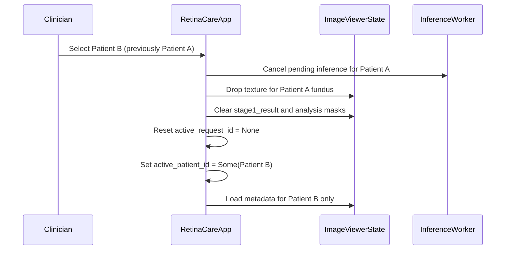

# GUI Phase 1 • Task 06: Privacy and Isolation Architecture

## 1. Cross-Patient Isolation Policy

Cross-patient data contamination is a critical clinical safety and privacy risk. The following isolation gates are enforced by the UI state machine:

### Invariants:
1. `mode_textures[0]` (active fundus scan) is deallocated and reset to `None` on patient switch.
2. `active_request_id` is cleared to ensure late-arriving inference worker results for Patient A are dropped silently.
3. `exam.patient_code` and `exam.exam_id` in `RetinalExaminationView` are updated atomically.
4. Plaintext export (`export_scoped_patient_session`) writes only records matching `exam.patient_code` and `exam.exam_id`.

---

## 2. Sensitive Plaintext Export Disclosures

Per Instruction 12:
- `export_scoped_patient_session()` produces unencrypted `.json` files.
- The UI modal must explicitly label the operation as:
  **"Plaintext Sensitive Export (Unencrypted JSON)"**
- It must state:
  > *"Warning: Plaintext patient and examination metadata will be exported to disk. This file is not protected by database-level SQLCipher encryption. Ensure destination media is encrypted."*
- It must require explicit user confirmation via `[Confirm Plaintext Export]`.
