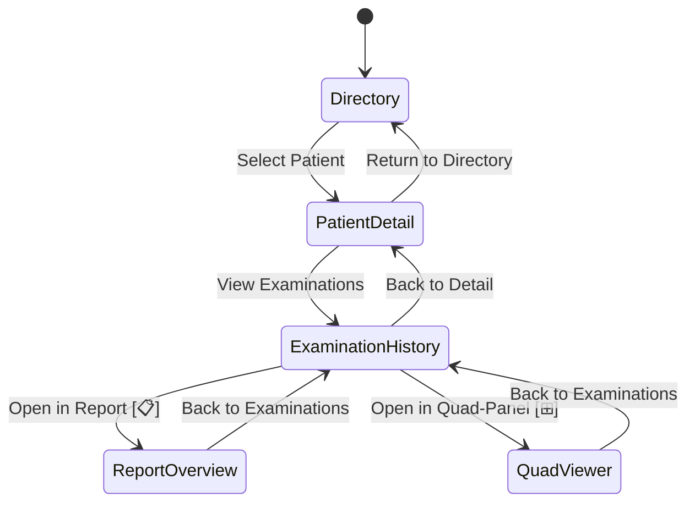
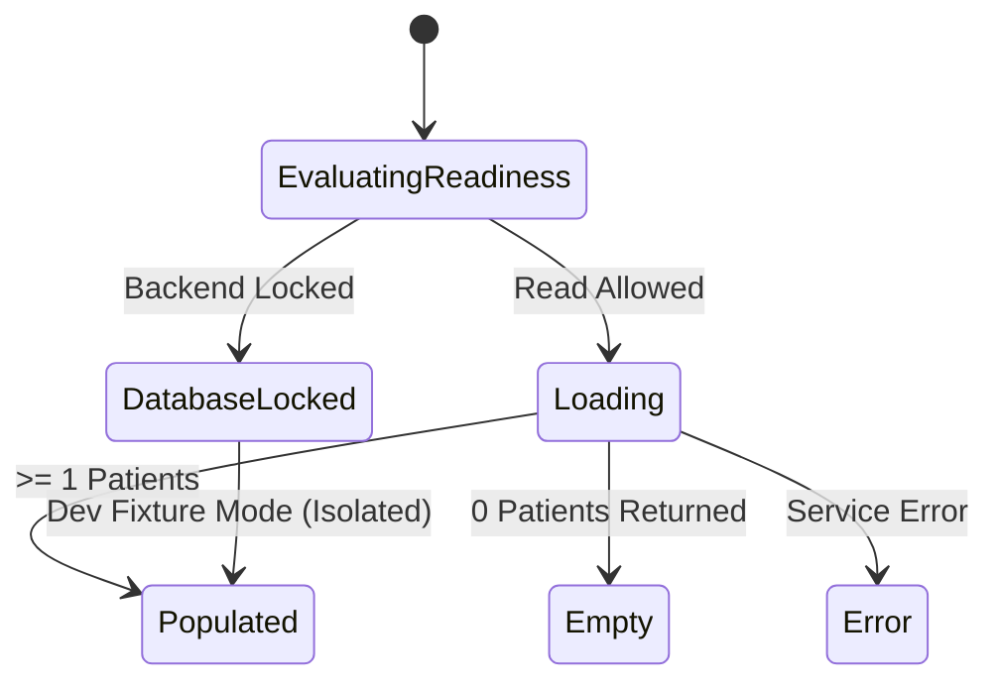

# GUI Phase 1 • Task 06: View State Machines

## 1. Primary Navigation Flow

---

## 2. Directory View State Machine

- **`DatabaseLocked`**: Renders banner explaining SQLCipher is locked; informs user that live patient records require clinician authentication.
- **`Empty`**: Renders zero-state illustration explaining no patients match the filter.
- **`Populated`**: Renders virtualized or scrollable table of patient cards with code, display name, exam count, and action buttons.
- **`Dev Fixture Mode`**: Clearly labeled with amber border tag `[DEV TEST FIXTURES ONLY - NON-CLINICAL]`.
