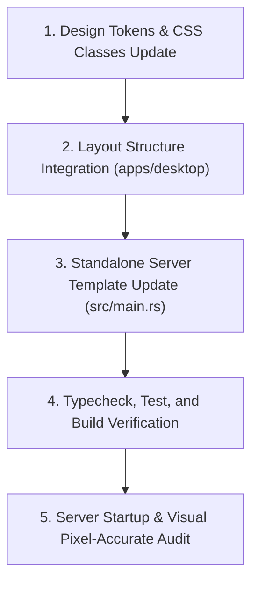

# Implementation Plan — Pixel-Accurate UI Frame Recreation



## 1. CSS Strategy & Visual Tokens
Update `apps/desktop/src/styles/design-tokens.css` and `apps/desktop/src/styles/index.css` to define:
- `--color-page-bg`: `transparent` (removes the unwanted black outer fill).
- `--color-frame-bg`: `#D8D8D8` (light grey substrate).
- `--color-dot-pattern`: `#9A9A9A` (darkened micro-dots, 0.85px radius, 6px pitch).
- `--color-pink-panel`: `#C78F90` (muted salmon-pink fill from Reference Image 3).
- `--radius-pink-panel`: `22px` (smooth 18px–24px rounded corners).
- `--color-panel-upper`: `#C2B3B3` / `#C2B6B6` (warm taupe/mauve upper side panels).
- `--color-panel-lower`: `#D8D8D8` (neutral light grey lower side panels).
- `--color-panel-bottom`: `#E0E0E0` (lower central panel fill).
- `--border-frame`: `5px solid #000000` (thick black outer border - PRESERVED).
- `--border-lower-panel`: `3.5px solid #000000` (black outline on lower card).
- `--radius-frame`: `24px` (large outer rounded corners).
- `--radius-panel-upper`: `20px` (upper side card rounded corners).
- `--radius-panel-lower`: `16px` (lower side and central card rounded corners).

---

## 2. Structural Layout Blueprint
The frame container retains its responsive 3-column layout while integrating the pink rounded rectangle:

```html
<div class="page-backdrop">
  <div class="main-frame">
    <!-- Left Column: 2 Vertical Panels -->
    <div class="side-column side-column-left">
      <div class="panel-upper panel-left-upper"></div>
      <div class="panel-lower panel-left-lower"></div>
    </div>

    <!-- Center Column: Pink Panel (Upper) + Lower Card -->
    <div class="center-column">
      <div class="center-content-slot">
        <!-- Reference Image 3: Muted Salmon-Pink Rounded Rectangle -->
        <div class="pink-panel">
          {children}
        </div>
      </div>
      <div class="panel-lower-center"></div>
    </div>

    <!-- Right Column: 2 Vertical Panels -->
    <div class="side-column side-column-right">
      <div class="panel-upper panel-right-upper"></div>
      <div class="panel-lower panel-right-lower"></div>
    </div>
  </div>
</div>
```

---

## 3. Affected Files
1. **`apps/desktop/src/styles/design-tokens.css`**: Define frame, border, and panel design tokens.
2. **`apps/desktop/src/styles/index.css`**: Implement CSS rules for `.page-backdrop`, `.main-frame`, `.side-column`, `.panel-upper`, `.panel-lower`, `.center-column`, and `.panel-lower-center`.
3. **`apps/desktop/src/layouts/CommandCenterLayout.tsx`**: Embed the frame and panel hierarchy around the existing website children.
4. **`src/main.rs`**: Mirror the pixel-accurate frame and panel structure in `STATIC_CANVAS_HTML` served by the native Rust executable server.

---

## 4. Responsive & Full-Screen Behavior
- **Full Viewport Expansion**: Remove `max-width: 1006px` and `max-height: 720px` from `.main-frame` so it expands to fill 100% of the screen.
- **Intentional Edge Inset**: `.page-backdrop` provides a subtle 8px-10px border margin around the perimeter, displaying the dark charcoal frame edge while maximizing usable screen area.
- **Fluid Panel Clamping**:
  - Side Columns: `width: clamp(160px, 14vw, 220px);` ensuring side panels scale naturally on wide screens without overcrowding.
  - Lower Central Card: `width: 100%; max-width: clamp(480px, 50vw, 720px); height: clamp(120px, 18vh, 160px);` centered at the base.
  - Center Content Slot: `flex: 1` dynamically expands to occupy all remaining vertical and horizontal space.
- **Desktop (>= 1024px)**: Full bento proportions filling the monitor, eliminating dark empty borders.
- **Tablet (768px - 1023px)**: Proportional scaling; outer margin scales down smoothly.
- **Mobile (< 768px)**: Adapts fluidly without clipping or dropping panels.

---

## 5. Visual Validation Checklist
- [ ] Unwanted black outer frame fill and surrounding black padding/shadow are completely removed.
- [ ] Outer black border (`5px solid #000000`) remains intact and visible around `.main-frame`.
- [ ] Light grey dotted background texture (`#D8D8D8` / `#9A9A9A`) remains intact.
- [ ] Pink rounded rectangle (`#C78F90`, `radius: 22px`, `border: none`) matches Reference Image 3.
- [ ] Pink rectangle is centered at 96% width and 92% height inside `.center-content-slot` with surrounding dotted canvas visible.
- [ ] Both left-side panels and both right-side panels remain visible and proportionally sized.
- [ ] Lower central panel remains visible with its black border.
- [ ] All existing website content, navigation, routes, and buttons are preserved.
- [ ] All workspace tests (`pnpm test`, `cargo test`) and typechecks pass with exit code 0.
