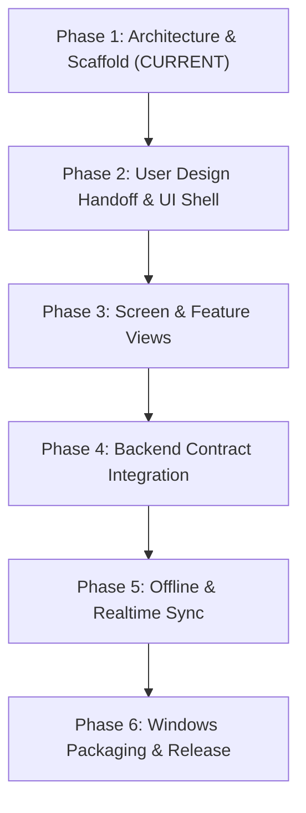

# Frontend Implementation Roadmap

## Phase Descriptions
- **Phase 1 (Current)**: Monorepo scaffolding, contract definitions, Tauri configuration, documentation.
- **Phase 2**: User delivers visual design tokens and screen mockups; implement neutral UI primitives.
- **Phase 3**: Implement command center screens and layouts.
- **Phase 4**: Connect to local/remote Rust services via typed contracts.
- **Phase 5**: Add local SQLite/IndexedDB offline caching.
- **Phase 6**: Produce signed Windows desktop installers.
